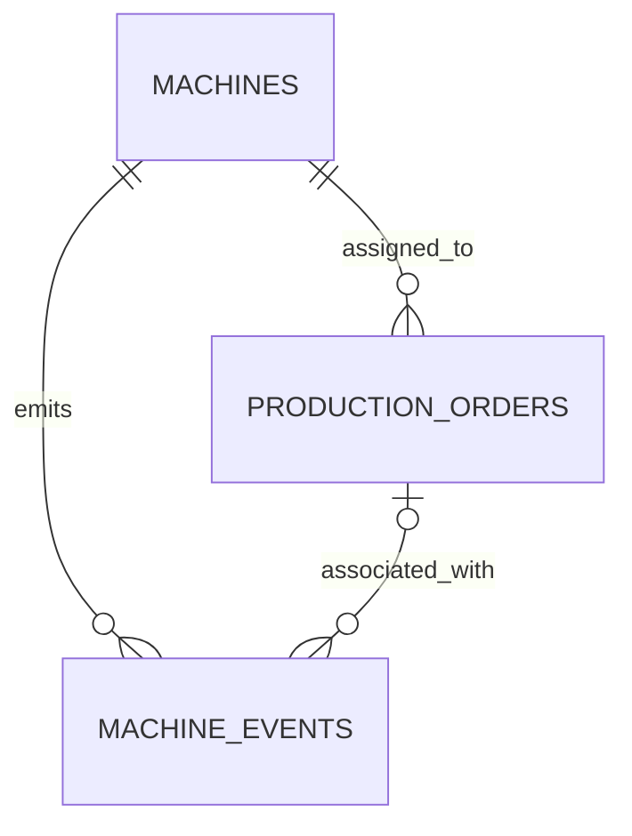

# FactoryPulse

**Industrial data engineering project | PostgreSQL · Docker · SQL**

FactoryPulse is a portfolio project that models manufacturing equipment, production orders and machine events as the foundation for an industrial analytics platform. It is being built in public, one working component at a time.

> **Current stage:** local PostgreSQL environment and SQL schema are available. Event simulation, cloud ingestion, lakehouse layers and dashboards are planned; they are not implemented in this repository yet.

## What this project demonstrates today

- A reproducible PostgreSQL 17 service with Docker Compose, a health check and persistent local storage.
- Relational modeling for `machines`, `production_orders` and `machine_events`.
- Database constraints for identifiers, valid order statuses, positive planned quantities and chronological order dates.
- Foreign keys that link orders to machines and ensure an event's order belongs to its machine.
- Event semantics that distinguish machine state changes from incremental production reports.

The repository currently contains infrastructure and SQL scripts. It does not yet contain a running streaming pipeline or measured performance results.

## Business context

Manufacturing teams need trustworthy answers about output, downtime and production progress. FactoryPulse uses a small operational model to explore questions such as:

- How much has each machine produced for a given order?
- How does reported output compare with the planned quantity?
- When did machines start, stop or report faults?
- How can operational records be validated before they reach analytics?

All data in this project is synthetic.

## Repository at a glance

```text
.
├── compose.yaml
├── README.md
└── sql/
    ├── 001_create_machines.sql
    ├── 002_create_production_orders.sql
    └── 003_create_machine_events.sql
```

| File | Purpose |
| --- | --- |
| [`compose.yaml`](compose.yaml) | Runs PostgreSQL 17 locally with a health check and named volume |
| [`001_create_machines.sql`](sql/001_create_machines.sql) | Defines equipment master data |
| [`002_create_production_orders.sql`](sql/002_create_production_orders.sql) | Defines orders and contains sample inserts and exploratory SQL |
| [`003_create_machine_events.sql`](sql/003_create_machine_events.sql) | Defines machine events and their integrity rules |

### Data model



- **`machines`** stores a unique machine code, name, installation date and active flag.
- **`production_orders`** stores the assigned machine, product, planned and produced quantities, status and schedule.
- **`machine_events`** stores timestamped starts, stops, faults and production reports. An event may have no order; when it does, the composite foreign key ties that order to the event's machine.

`PRODUCTION_REPORTED` values represent **increments**, not lifetime totals. Two reports of 300 and 450 units therefore contribute 750 units. Other event types require `units_produced = 0`.

## Run locally

**Prerequisites:** Docker with Compose support and a PostgreSQL client such as `psql` or DBeaver.

1. Clone this repository and enter its directory.
2. Create a local `.env` file:

   ```dotenv
   POSTGRES_USER=factorypulse
   POSTGRES_PASSWORD=choose-a-local-password
   POSTGRES_DB=factorypulse
   ```

3. Start PostgreSQL and check its status:

   ```bash
   docker compose up -d
   docker compose ps
   ```

4. Open `psql` in the container:

   ```bash
   docker compose exec postgres psql -U factorypulse -d factorypulse
   ```

The database is available to local clients on `127.0.0.1:5433`. Docker stores its data in the named `postgres_data` volume. The `.env` file is ignored by Git.

**Schema setup note:** the SQL files are currently development scripts, not a clean automated migration sequence. In particular, `002_create_production_orders.sql` includes sample inserts and an intentionally invalid example; running all three files unattended is not a supported setup path yet. The table definitions can be inspected and executed interactively in numerical order. Automated, repeatable migrations are a next step.

## Engineering choices

| Decision | Reason |
| --- | --- |
| Enforce rules in PostgreSQL | Protects integrity regardless of which process writes the records |
| Keep machine events separate from orders | Captures stops and faults even when no order is active |
| Use a composite machine–order relationship | Prevents an event from attributing an order to the wrong machine |
| Store production as event increments | Makes output aggregable by machine, order and time window |
| Persist PostgreSQL in a Docker volume | Keeps local data across routine container recreation |

## Roadmap

| Stage | Status | Intended outcome |
| --- | --- | --- |
| Operational schema and local database | **In progress** | Clean, repeatable migrations; validated event inserts; automated SQL checks |
| Industrial event simulator | Planned | Configurable synthetic production and fault events |
| Ingestion | Planned | Batch extraction and event streaming with failure handling |
| Lakehouse | Planned | Bronze, Silver and Gold datasets with documented transformations |
| Analytics and operations | Planned | Manufacturing KPIs, monitoring and recovery tests |

The target architecture may use Python, Azure Event Hubs, Azure Data Factory, Azure Data Lake Storage, Databricks/PySpark, Delta Lake, dbt, Power BI, Terraform and GitHub Actions. These are **design intentions**, not technologies already delivered here. Each addition will be documented with runnable instructions and evidence when implemented.

## Scope and limitations

FactoryPulse is a learning and portfolio project using synthetic data. The current repository demonstrates local database setup and schema design. Streaming, cloud deployment, analytical models, dashboards, automated tests and performance benchmarks remain future work. No production readiness or real-time latency claim is made at this stage.
