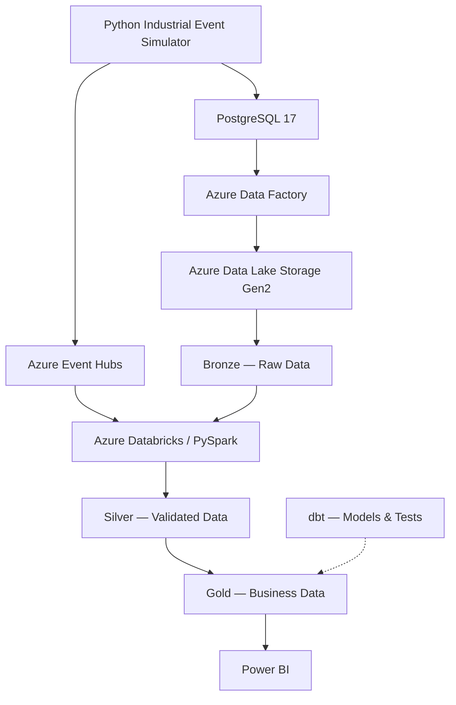

# FactoryPulse

### Real-Time Industrial Data Lakehouse

**An end-to-end Data Engineering portfolio project for industrial data processing and analytics.**

**Project status:** 🚧 Under Active Development — PostgreSQL Data Modeling & Validation

---

## Overview

FactoryPulse is a hands-on Data Engineering project designed to simulate how a manufacturing company collects, validates, processes, and analyzes operational data.

The project focuses on building a modern data platform around industrial equipment, production orders, and machine-generated events.

The long-term objective is to develop an end-to-end data architecture that supports batch and streaming ingestion, scalable transformations, data quality checks, and business intelligence.

Rather than being a standalone analytics dashboard, FactoryPulse is designed to demonstrate the engineering practices behind a reliable data platform: data modeling, orchestration, processing, testing, infrastructure management, and observability.

> **Development approach:** The platform is being built incrementally, with each component implemented, tested, and documented before proceeding to the next stage.

## Business Problem

Manufacturing companies need reliable operational data to understand production performance and equipment availability.

However, this information is often distributed across operational databases, machine-generated events, and reporting systems.

FactoryPulse aims to address questions such as:

- How many units are produced by each machine and production order?
- Which machines experience the most frequent stops and faults?
- How does actual production compare with planned production?
- How can operational events be ingested and processed with low latency?
- How can data quality be enforced consistently across different systems?
- How can historical production data be made available for reporting and analysis?

## Architecture

The following diagram represents the **target architecture**. Cloud services and streaming components are planned and have not yet been deployed.



The architecture separates operational systems, data ingestion, transformation, and analytics.

The platform will use a Medallion architecture to organize data into Bronze, Silver, and Gold layers.

### Technology Stack

| Component                       | Technology                   | Purpose                                   | Status              |
| ------------------------------- | ---------------------------- | ----------------------------------------- | ------------------- |
| Containerization                | Docker / Docker Compose      | Reproducible local environment            | Implemented         |
| Operational database            | PostgreSQL 17                | Relational data storage and integrity     | Implemented         |
| Data generation                 | Python                       | Simulated industrial events               | Planned             |
| Batch ingestion                 | Azure Data Factory           | Extract and orchestrate source data       | Planned             |
| Streaming ingestion             | Azure Event Hubs             | Event streaming                           | Planned             |
| Data lake                       | Azure Data Lake Storage Gen2 | Cloud object storage                      | Planned             |
| Distributed processing          | Azure Databricks / PySpark   | Scalable data transformations             | Planned             |
| Lakehouse storage               | Delta Lake                   | Transactional analytical tables           | Planned             |
| Data transformation & testing   | dbt                          | Analytical models and data quality        | Planned             |
| Infrastructure as Code          | Terraform                    | Reproducible cloud infrastructure         | Planned             |
| CI/CD                           | GitHub Actions               | Automated validation and deployment       | Planned             |
| Analytics                       | Power BI                     | Operational dashboards                    | Planned             |
| Additional platform exploration | Snowflake                    | Optional cloud data warehouse integration | Under consideration |

## Data Model

The operational data model consists of three entities.

### 1. `machines`

Stores master data about manufacturing equipment.

| Column         | Description                         |
| -------------- | ----------------------------------- |
| `machine_id`   | Auto-generated primary key          |
| `machine_code` | Unique business identifier          |
| `machine_name` | Descriptive equipment name          |
| `installed_at` | Installation date                   |
| `is_active`    | Active/inactive registration status |

The table enforces unique machine codes and mandatory machine names.

### 2. `production_orders`

Represents manufacturing orders assigned to equipment.

| Column              | Description                       |
| ------------------- | --------------------------------- |
| `order_id`          | Auto-generated primary key        |
| `order_code`        | Unique production order code      |
| `machine_id`        | Reference to the assigned machine |
| `product_code`      | Product identifier                |
| `planned_quantity`  | Target production quantity        |
| `produced_quantity` | Recorded total production         |
| `status`            | Current production order status   |
| `planned_start_at`  | Planned starting timestamp        |
| `planned_end_at`    | Planned completion timestamp      |
| `created_at`        | Record creation timestamp         |

Supported statuses:

- `PLANNED`
- `IN_PROGRESS`
- `COMPLETED`
- `CANCELLED`

Database constraints enforce positive planned quantities, nonnegative production quantities, valid statuses, and chronological consistency.

### 3. `machine_events`

Designed to represent timestamped manufacturing events.

| Column           | Description                       |
| ---------------- | --------------------------------- |
| `event_id`       | Auto-generated primary key        |
| `machine_id`     | Machine producing the event       |
| `order_id`       | Optional related production order |
| `event_type`     | Type of industrial event          |
| `event_at`       | Event occurrence timestamp        |
| `units_produced` | Incremental production quantity   |
| `created_at`     | Database insertion timestamp      |

Planned event types:

- `MACHINE_STARTED`
- `MACHINE_STOPPED`
- `PRODUCTION_REPORTED`
- `FAULT_DETECTED`

Production quantities follow an **incremental event model**, rather than a cumulative counter model.

For example, reports of 300 and 450 units represent 750 units produced across those events.

The design separates production reporting from machine state changes. Before a machine stops, the event generator is expected to report any outstanding production quantity.

**Current status:** SQL design reviewed; deployment and integration testing are pending.

## Engineering Decisions

### Referential Integrity

Foreign keys are used to prevent production orders from referencing nonexistent machines.

The event data model additionally incorporates a composite foreign key design to ensure that a reported production order belongs to the machine associated with the event.

An independent machine foreign key remains necessary because operational events may occur without an active production order.

### Database-Level Validation

PostgreSQL constraints enforce core business rules independently of application-level validation.

This helps protect data integrity when records originate from different applications, scripts, or ingestion processes.

### Event Semantics

Production reports represent incremental quantities, enabling downstream aggregation by machine, production order, and time window.

Machine state events are handled independently from production reports.

### Data Persistence

The local PostgreSQL service uses a Docker named volume to retain database state across ordinary container recreation.

SQL schema definitions are maintained separately so that database structures can be recreated and version-controlled.

### Reproducibility and Security

Infrastructure and schema definitions are intended to be reproducible from version-controlled files.

Local credentials are stored outside version control. The `.env` file must not be committed to Git.

## Local Development

### Prerequisites

- Docker Desktop or Docker Engine with Compose support
- Git
- A code editor such as VS Code
- An optional PostgreSQL client such as DBeaver

### Start PostgreSQL

From the project root, create a local `.env` file with the following variables, replacing the example password with a strong local password:

```dotenv
POSTGRES_USER=factorypulse
POSTGRES_PASSWORD=replace-with-a-strong-local-password
POSTGRES_DB=factorypulse
```

Start the service:

```bash
docker compose up -d
```

Check the container status:

```bash
docker compose ps
```

Open the PostgreSQL command-line client:

```bash
docker compose exec postgres psql -U factorypulse -d factorypulse
```

The project exposes PostgreSQL locally through `127.0.0.1:5433`, mapped to port `5432` inside the container.

SQL schema scripts are being organized under the `sql/` directory. Automated schema provisioning is a future improvement.

## Project Structure

Target repository organization as development progresses:

```text
factorypulse/
├── README.md
├── compose.yaml
├── .env.example
├── .gitignore
├── sql/
│   ├── 001_create_machines.sql
│   ├── 002_create_production_orders.sql
│   └── 003_create_machine_events.sql
├── simulator/
├── ingestion/
├── databricks/
├── dbt/
├── infrastructure/
├── tests/
└── .github/
    └── workflows/
```

Some directories and files shown above are planned and may not exist in the current development version.

## Development Progress

### Phase 1 — Operational Database

- [x] Configure PostgreSQL 17 with Docker Compose
- [x] Configure local persistent storage
- [x] Implement database healthcheck
- [x] Create and validate the `machines` table
- [x] Create and validate the `production_orders` table
- [x] Insert sample production orders
- [x] Test uniqueness, referential integrity, and quantity constraints
- [x] Test valid status values and chronological rules
- [x] Review the `machine_events` relational model
- [ ] Finalize and version all SQL schema scripts
- [ ] Deploy and validate `machine_events`
- [ ] Complete event insertion and referential integrity tests

### Phase 2 — Industrial Event Simulation

- [ ] Build a configurable Python event generator
- [ ] Simulate machine starts, stops, faults, and production activity
- [ ] Generate realistic timestamps and production patterns
- [ ] Introduce invalid and duplicate events for testing

### Phase 3 — Data Ingestion

- [ ] Implement batch extraction from PostgreSQL
- [ ] Build Azure Data Factory pipelines
- [ ] Introduce Azure Event Hubs for streaming events
- [ ] Establish ingestion validation and failure handling

### Phase 4 — Data Lakehouse

- [ ] Implement Bronze, Silver, and Gold data layers
- [ ] Develop PySpark transformations
- [ ] Store analytical data using Delta Lake
- [ ] Implement incremental processing and deduplication
- [ ] Introduce dbt models and automated data quality tests

### Phase 5 — Analytics and Reliability

- [ ] Build manufacturing KPIs and production dashboards
- [ ] Implement logging and pipeline monitoring
- [ ] Test recovery from processing failures
- [ ] Benchmark pipeline performance

### Phase 6 — Infrastructure and Delivery

- [ ] Provision cloud resources using Terraform
- [ ] Implement CI/CD workflows with GitHub Actions
- [ ] Document deployment and operational procedures
- [ ] Evaluate an optional Snowflake integration

## Data Quality Strategy

FactoryPulse adopts a layered approach to data quality.

**At the source:** PostgreSQL enforces structural and relational constraints.

**During ingestion:** pipelines will validate incoming records, timestamps, and ingestion behavior.

**During transformation:** data quality tests will identify invalid, missing, duplicate, and inconsistent records.

**At the analytics layer:** business metrics will be checked for consistency with source events and production orders.

## Learning Objectives

This project is being developed to demonstrate practical knowledge in:

- Relational database design and SQL
- Batch and streaming data processing
- Data modeling and referential integrity
- Python-based data engineering
- Distributed processing with Apache Spark
- Cloud data platforms and lakehouse architecture
- Automated testing and data quality
- Infrastructure as Code and CI/CD
- Monitoring, documentation, and reproducibility

The emphasis is on understanding architecture and implementation decisions, not simply integrating tools.

## Current Limitations

FactoryPulse is a learning and portfolio project using simulated manufacturing data.

The cloud architecture, event streaming platform, and analytical layers are not yet deployed. Performance characteristics and scalability will be evaluated during later development phases.

No production availability, latency, or throughput claims are made at this stage.

---

**FactoryPulse — From industrial machine events to reliable, actionable data.**
