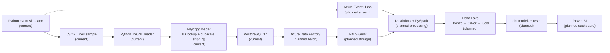
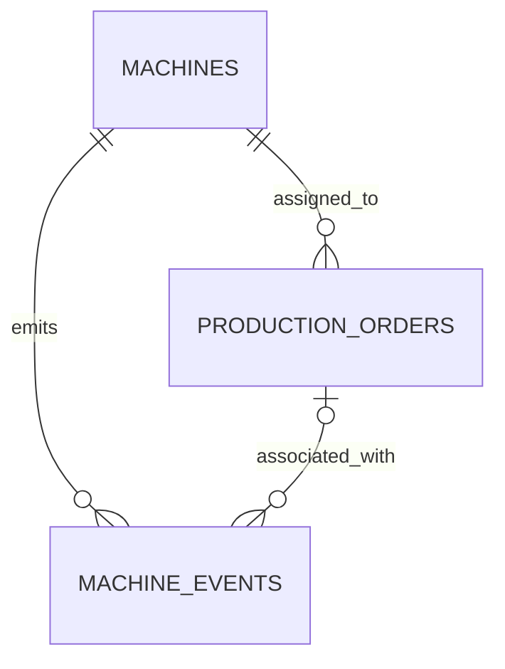

# FactoryPulse

### From industrial operations to an analytics-ready lakehouse

**An evolving data engineering portfolio project built around manufacturing equipment, production orders and machine events.**

[](#project-status)
[](#technology-roadmap)
[](#scope-and-limitations)
[](#run-the-local-event-example)

**In use now** · Python 3.12+ · PostgreSQL 17 · SQL · Docker Compose · Psycopg 3 · python-dotenv · JSON Lines · unittest · Git/GitHub

**Planned cloud and analytics stack** · Azure Data Factory · Event Hubs · ADLS Gen2 · Databricks/PySpark · Delta Lake · dbt · Power BI · Snowflake · Terraform · GitHub Actions

**Delivered locally** · Operational schema and summary view · Event simulator · Payload validation · Machine/order ID lookup · Transactional PostgreSQL ingestion · Duplicate skipping by source ID

FactoryPulse models a realistic manufacturing data flow: operational records are generated, validated, ingested, transformed and ultimately made available for reporting. The project is being developed in stages so that each new tool has a clear role and a working result.

> **Where the project stands:** PostgreSQL 17 runs locally with Docker Compose. Five numbered SQL files define the operational tables, production-report constraint and order summary view. A deterministic Python simulator emits seven machine events as JSON Lines. The reader validates required fields, types, nonblank strings, explicit timestamp offsets, allowed event types and production units. The Psycopg loader resolves business codes to machine/order IDs and inserts events in one transaction, skipping existing source IDs. A local replay was demonstrated with **7 inserted / 0 skipped**, followed by **0 inserted / 7 skipped**. Sixteen Python unit tests cover selected simulator and reader rules. SQL constraint checks and a manual view check are also present; the view check's fixtures still need source IDs. Azure services, lakehouse processing, orchestration and dashboards remain planned.

## Why this project exists

Manufacturers need consistent answers about production output, equipment availability and faults. Those answers are difficult to trust when order data, machine events and reports follow different rules.

FactoryPulse is designed to answer:

- How many units did a machine produce for each order and time period?
- How does actual output compare with the production plan?
- When did a machine start, stop or report a fault?
- Can an event be linked to the correct machine and production order?
- How do we detect duplicate, late, invalid or missing events before reporting them?

This is a **synthetic-data portfolio project**, not a production factory system.

## Project status

| Area | Status | Evidence / next deliverable |
| --- | --- | --- |
| Local PostgreSQL environment | **Implemented** | [Docker Compose configuration](compose.yaml), health check, persistent volume |
| Operational data model | **SQL files present** | [Machines](sql/001_create_machines.sql), [orders](sql/002_create_production_orders.sql), [events](sql/003_create_machine_events.sql), [production-report rule](sql/004_enforce_production_report_payload.sql), [order summary view](sql/005_create_order_production_summary_view.sql) |
| Database setup and verification | **Implemented locally** | Numbered database files are separate from [demo data](seeds/demo_data.sql); [constraint checks](tests/test_constraints.sql), a [view result check](tests/test_order_production_summary.sql), and [execution instructions](TESTING.md) are available |
| Operational documentation | **Updated for the local pipeline** | [Data dictionary](docs/data_dictionary.md) and [machine event contract](docs/event_contract.md), separating current SQL/application guarantees from open decisions |
| Event simulation | **Implemented, fixed scenario** | [Python simulator](src/simulator/generate_events.py) validates state transitions, event order and unit increments, then emits [seven sample events](events.jsonl) |
| Local JSONL reading | **Implemented** | [Reader](src/ingestion/read_events.py) validates record shape, required fields, types, timestamp offsets, event types and unit rules |
| PostgreSQL event ingestion | **Implemented locally** | [Loader](src/ingestion/db.py) resolves matching machine/order IDs, uses parameterized SQL, commits the file as one transaction and skips duplicate `source_event_id` values |
| Python unit tests | **Implemented** | [Simulator tests](tests/test_generate_events.py) and [reader tests](tests/test_read_events.py); sixteen cases cover the current examples |
| Batch and streaming ingestion | Planned | Azure Data Factory and Azure Event Hubs pipelines |
| Lakehouse transformations | Planned | ADLS Gen2, Databricks/PySpark, Delta Lake and Bronze/Silver/Gold datasets |
| Analytical models and dashboards | Planned | dbt models and tests, manufacturing KPIs and Power BI |
| Snowflake analytical serving | Planned, after core lakehouse | Load curated datasets, build SQL/dbt marts and compare analytical delivery paths |
| Infrastructure and delivery | Planned | Terraform, GitHub Actions, monitoring and deployment documentation |

**Current focus:** verify persisted event totals and strengthen the local ingestion checks before cloud integration. A checked item below means a file or demonstrated capability exists; planned tools explain direction, not completed experience.

## Architecture

The diagram distinguishes the **current local components** from the planned cloud pipeline. The reader returns validated records to the loader, which resolves internal IDs and writes to PostgreSQL. Streaming publication and cloud processing remain future work.



**Design intent:** combine operational data and event streams, preserve raw inputs, validate and standardise records, then publish documented business metrics. The implementation will evolve as each stage is built and tested.

## Technology roadmap

| Technology / practice | Role in FactoryPulse | Status |
| --- | --- | --- |
| SQL + PostgreSQL 17 | Operational schema, constraints, view and queries | **In use** |
| Docker + Docker Compose | Reproducible local database and persistent storage | **In use** |
| Git + GitHub | Version control and project documentation | **In use** |
| Python 3.12+ | Deterministic event simulation, payload validation and ingestion | **In use** |
| Psycopg 3 | Parameterized PostgreSQL queries and connection/transaction management | **In use** |
| python-dotenv | Load local connection settings from `.env` | **In use** |
| JSON Lines | Local sample event exchange format | **In use** |
| `unittest` | Checks for simulator rules and malformed JSONL records | **In use** |
| SQL constraint checks | Validate database rules in a rollback-only test transaction | **Implemented and run locally** |
| Azure Data Factory | Batch extraction and workflow orchestration | Planned |
| Azure Event Hubs | Streaming event ingestion | Planned |
| Azure Data Lake Storage Gen2 | Raw and processed cloud storage | Planned |
| Azure Databricks + PySpark | Distributed event and batch transformations | Planned |
| Delta Lake | Reliable analytical tables and incremental processing | Planned |
| dbt | Analytical models, documentation and data tests | Planned |
| Power BI | Production and equipment KPI dashboards | Planned |
| Snowflake | Alternative analytical warehouse for curated datasets and comparison with Delta Lake | Planned, later stage |
| Terraform | Reproducible Azure infrastructure | Planned |
| GitHub Actions | Continuous validation and deployment workflows | Planned |
| Monitoring and logging | Pipeline health, failures and recovery | Planned |

**Optional exploration:** Microsoft Fabric may be evaluated after the core pipeline is complete. Snowflake is a later project stage with a specific deliverable: publish curated data, model a small analytical mart and compare it with the Delta Lake path. The roadmap favours depth and working evidence over adding tools solely for a longer list.

## Operational data model



| Entity | Purpose | Key rules |
| --- | --- | --- |
| `machines` | Equipment master data | Generated primary key; unique machine code; required name |
| `production_orders` | Product, planned quantity and schedule for a machine | Machine foreign key; positive planned quantity; valid status; end after start |
| `machine_events` | Timestamped starts, stops, faults and production reports | Machine foreign key; matching machine–order pair; required unique `source_event_id` (`varchar(20)`); production reports require an order and positive units after 004 |

Order statuses are `PLANNED`, `IN_PROGRESS`, `COMPLETED` and `CANCELLED`. Event types are `MACHINE_STARTED`, `MACHINE_STOPPED`, `PRODUCTION_REPORTED` and `FAULT_DETECTED`.

The [data dictionary](docs/data_dictionary.md) documents each column and relationship. The [event contract](docs/event_contract.md) describes the intended event payload and rules; the current simulator enforces its state sequence and unit rules for the generated scenario. The [summary view](sql/005_create_order_production_summary_view.sql) calculates production totals from accepted report events. `production_orders` stores the order plan and status, not a second copy of the calculated total.

### Event design decisions

- **Production is incremental.** Reports of 300 and 450 units contribute 750 units, rather than representing two cumulative readings.
- **State changes are distinct from output.** Starts, stops and faults carry zero `units_produced`.
- **SQL and ingestion have different order requirements.** SQL permits no order for starts, stops and faults. The current JSONL reader requires a nonblank `order_code` on every event, and the loader requires a matching registered machine/order pair.
- **An order must belong to the event's machine.** The composite foreign key prevents mismatched attribution.
- **Source identity survives retries.** `source_event_id` is globally unique across machines and sources. `ON CONFLICT (source_event_id) DO NOTHING` skips repeats; it does not compare or update their payloads.
- **Database IDs and source IDs serve different roles.** `event_id` identifies a stored row; `source_event_id` identifies the producer's occurrence across reprocessing.

PostgreSQL enforces the row-level constraints above. The Python simulator validates start/stop/fault sequences in its fixed scenario; PostgreSQL does not enforce those transitions. Order status at report time is not yet enforced.

## Run the current stage locally

**Prerequisites:** Docker with Compose support, Git, Python 3.12+ for the current source syntax, and an optional PostgreSQL client such as DBeaver. Python dependencies are installed manually below; a dependency lockfile has not yet been added.

1. Clone this repository and enter its directory.
2. Create a local `.env` file:

   ```dotenv
   POSTGRES_USER=factorypulse
   POSTGRES_PASSWORD=choose-a-strong-local-password
   POSTGRES_DB=factorypulse

   PGHOST=127.0.0.1
   PGPORT=5433
   PGDATABASE=factorypulse
   PGUSER=factorypulse
   PGPASSWORD=choose-a-strong-local-password
   ```

3. Start the service and inspect its health:

   ```bash
   docker compose up -d
   docker compose ps
   ```

4. Open `psql`:

   ```bash
   docker compose exec postgres psql -U factorypulse -d factorypulse
   ```

PostgreSQL is bound to `127.0.0.1:5433` on the host and uses a Docker named volume for local persistence. The `POSTGRES_*` settings configure the container; `PG*` settings are read by `db.py`. Keep the username, database and password consistent between both groups. The `.env` file is excluded from version control.

> **Setup and verification:** apply all five numbered SQL files in numerical order to a fresh database. Optional data lives in `seeds/`, and SQL constraint checks use a separate `factorypulse_test` database. See [TESTING.md](TESTING.md). These scripts are not yet managed by a migration tool; automated CI execution is still planned. Recreate a disposable database after changes to a creation script: rerunning `CREATE TABLE IF NOT EXISTS` does not change an existing table.

### Run the local event example

From the repository root, create a virtual environment and install the two runtime dependencies. On Windows, activate it with `.venv\Scripts\Activate.ps1`; on Bash, use `source .venv/bin/activate`.

```bash
python -m venv .venv
# Activate the environment using the command for your shell, then:
python -m pip install "psycopg[binary]" python-dotenv
```

Generate the deterministic JSONL sample, inspect it with the reader and run the Python tests:

```bash
python src/simulator/generate_events.py > events.jsonl
python src/ingestion/read_events.py
python -m unittest discover -s tests -v
```

The reader prints `7` and `25` for this sample: seven records, with 25 units in the second event. The Python unit suite currently contains **16 tests**. The committed [events.jsonl](events.jsonl) is a sample; rerunning the first command replaces it with the same deterministic scenario.

After applying SQL files 001–005 and loading the optional demo seed once into a fresh demo database, run the loader from the repository root:

```bash
python src/ingestion/db.py
python src/ingestion/db.py
```

The first load of the seven new simulator IDs reports `7 lines inserted, 0 lines skipped`. A replay reports `0 lines inserted, 7 lines skipped`. The loader prints these counters after the transaction commits. A missing machine/order pair or another unhandled error rolls back that run's database changes. The script currently uses `events.jsonl` as a fixed input path.

**Verification boundary:** these replay counters were observed locally; the next manual check is to query stored simulator events and confirm **7 rows / 35 units**. If the demo seed's 120-unit report is present, the order view includes it as well: expect **155 units** for `PO-001` after one simulator load, rather than 35. See [TESTING.md](TESTING.md) for separate Python and SQL checks and the known view-fixture gap.

## Implementation plan

### Phase 1 — Operational foundation · **in progress**

- [x] Run PostgreSQL 17 with Docker Compose, health check and persistent volume.
- [x] Write SQL definitions for machines, production orders and machine events.
- [x] Separate schema definitions, optional demo data and negative test cases.
- [x] Verify schema creation from a clean database manually.
- [x] Add SQL-only checks for constraints and machine–order integrity.
- [x] Require an order and positive units for production reports; add an order production summary view and a manual result check.
- [x] Execute the checks in a temporary PostgreSQL 17 container and confirm that test rows are rolled back.
- [ ] Document a complete, verified local setup.

### Phase 2 — Simulated industrial data

- [x] Build a deterministic Python simulator with a reproducible fixed scenario.
- [x] Generate production increments, state changes and faults as JSONL.
- [x] Validate event order, machine state transitions and unit increments; add unit tests.
- [ ] Make the simulator configurable and add multiple machines and orders.
- [ ] Introduce duplicates, late arrivals and invalid records for quality tests.
- [ ] Complete and review the [event contract](docs/event_contract.md) against later ingestion behavior.

### Phase 3 — Ingestion and processing

- [x] Read local JSONL, reject malformed JSON and require the event's six fields.
- [x] Validate field types, nonblank strings, event timestamps with offsets, event types and unit rules.
- [x] Resolve machine/order codes and load accepted events into PostgreSQL using parameterized queries.
- [x] Add required unique source event IDs and skip duplicate inserts; demonstrate local replay counters.
- [ ] Verify persisted simulator row counts and production totals after replay.
- [ ] Add automated database integration checks and update the manual view-check fixtures for required source IDs.
- [ ] Implement batch extraction from PostgreSQL using Azure Data Factory.
- [ ] Publish and consume events through Azure Event Hubs.
- [ ] Land raw data in ADLS Gen2.
- [ ] Process data with Databricks/PySpark and Delta Lake.
- [ ] Build Bronze, Silver and Gold layers with incremental logic and deduplication.

### Phase 4 — Analytics and reliability

- [ ] Define dbt models, lineage and automated data tests.
- [ ] Publish KPIs such as throughput, production attainment and downtime.
- [ ] Create a Power BI dashboard with documented metric definitions.
- [ ] Publish curated datasets to Snowflake, build a small SQL/dbt mart and compare its results and operating trade-offs with the Delta Lake Gold layer.
- [ ] Add pipeline logging, failure handling and recovery checks.
- [ ] Provision infrastructure with Terraform and validate changes with GitHub Actions.

The deliverable for each phase is runnable code, a reproducible setup and evidence that the data rules work. Tool choices may change if a simpler solution better serves the learning objective.

## Repository structure

```text
.
├── .gitignore
├── README.md
├── TESTING.md
├── compose.yaml
├── events.jsonl
├── docs/
│   ├── data_dictionary.md
│   └── event_contract.md
├── seeds/
│   └── demo_data.sql
├── src/
│   ├── ingestion/
│   │   ├── db.py
│   │   └── read_events.py
│   └── simulator/
│       └── generate_events.py
├── tests/
│   ├── test_constraints.sql
│   ├── test_generate_events.py
│   ├── test_order_production_summary.sql
│   └── test_read_events.py
└── sql/
    ├── 001_create_machines.sql
    ├── 002_create_production_orders.sql
    ├── 003_create_machine_events.sql
    ├── 004_enforce_production_report_payload.sql
    └── 005_create_order_production_summary_view.sql
```

Only existing files are shown here. New directories will be added as their stages are implemented.

## Scope and limitations

FactoryPulse uses synthetic manufacturing data. The repository currently demonstrates a local PostgreSQL environment, SQL schema and checks, a fixed Python event simulator, a JSONL sample, a local JSONL reader and unit tests. The reader validates record structure, types, nonblank strings, parseable timestamps with offsets and event payload rules. The loader persists accepted events with duplicate skipping. It does not enforce machine-state sequences against historical database events, detect a changed payload under an existing source ID or implement late-event handling. The reader does not validate every SQL length/range limit, and all JSONL events currently require an order code. The manual SQL view check still needs source IDs in its fixtures. Cloud streaming remains planned. No cloud platform, analytical layers, dashboards or measured latency and throughput are deployed.
